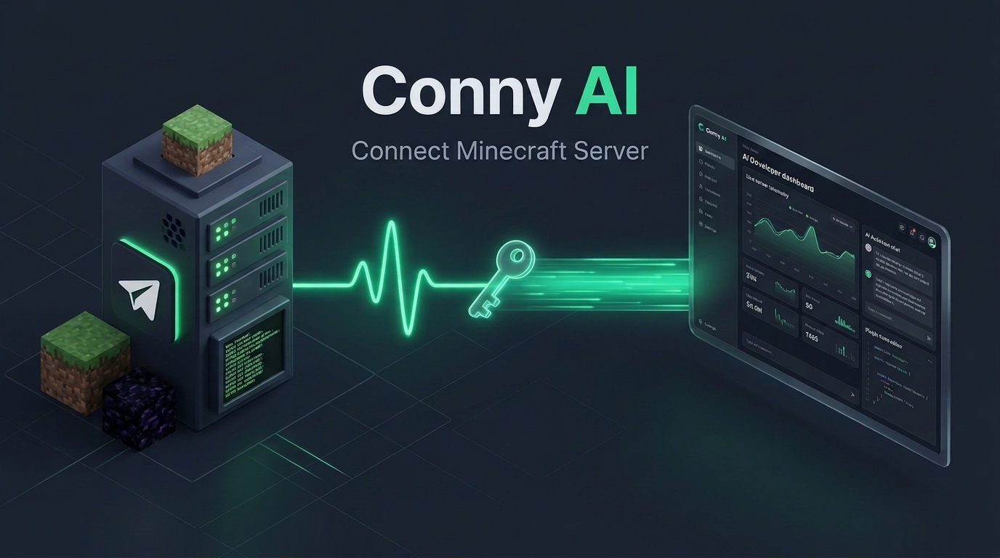

# 🌐 How to Connect Your Minecraft Server to Vexo AI (Step-by-Step Visual Guide)



This guide walks you through connecting your Minecraft server (**SFTP, RCON, Local Directory, or Demo Sandbox**) to **Vexo AI Studio**.

---

## 📋 Prerequisites
1. **Vexo AI Studio** running on `http://localhost:3000` (or hosted on Netlify).
2. Your Minecraft server (running on any host or locally).
3. Your server's SFTP credentials and RCON port/password.

---

## 🚀 Step 1: Open Vexo AI Studio & Click "+ Connect Server"

1. Open your browser and go to your Vexo AI Studio URL (`http://localhost:3000` or Netlify).
2. Click **Open Server Studio**.
3. In the top bar, click the **`+ Connect Server`** button.

---

## ⚙️ Step 2: Configure Connection & Test Ping

In the **Connect Minecraft Server** dialog:

1. **Server Display Name**: Enter a name (e.g. `Survival SMP`, `My Paper Server`).
2. **Choose Connection Method**:
   - 🔌 **SFTP + RCON** (Recommended for Hosting Providers):
     - **SFTP Host**: Your server domain or IP (e.g., `sftp.myhost.com` or `51.79.12.34`)
     - **SFTP Port**: Usually `2022` or `22`
     - **Username & Password**: Your hosting panel credentials
     - **RCON Host**: Leave blank to match SFTP Host
     - **RCON Port**: `25575`
     - **RCON Password**: Your `rcon.password` from `server.properties`
   - 📁 **Local Folder** (Zero Port-Forwarding!):
     - Simply select the folder path on your computer (e.g. `D:\Minecraft\SurvivalServer`).
     - Vexo AI will directly read and edit your configs on disk!
3. Click the **Test Ping** button.

You will see an immediate green confirmation badge:
```
✓ Success! Connected via SFTP in 45ms. [Paper 1.20.4] | Files Detected: 12 | RCON: CONNECTED
```

4. Click **Save & Connect**!

---

## 🟢 Step 3: Start Developing & Managing Your Server!

Once connected, your top bar lights up with live real-time telemetry:

```
🟢 ONLINE (45ms) | 20.00 TPS | 32ms MSPT | 1.8GB RAM | 6/40 Players
```

### What You Can Do Now:
- **AI Chat**: Ask Vexo to optimize lag, configure `server.properties`, set up LuckPerms ranks, or write Skript mechanics.
- **Java Plugin Builder**: Ask Vexo to code a custom Java plugin, click **Compile & Package .JAR**, and deploy it live!
- **Live Console**: View colorized server logs in real-time and run commands with destructive action safety warnings.
- **File Explorer**: Browse and edit plugin configs with one-click backups (`.vexo.bak`).

---

## ❓ Troubleshooting & FAQs

### Q: "SFTP Connection Failed: Connection refused"
- **Fix**: Verify your SFTP Host and Port. Many Minecraft hosts use port `2022` instead of standard `22`.

### Q: "RCON is not configured"
- **Fix**: Make sure `enable-rcon=true` is set in your `server.properties` and your password matches.

### Q: Can I manage multiple servers?
- **Yes!** Click `+ Connect Server` again to add as many servers as you want (e.g., Survival, Skyblock, Minigames). Switch between them instantly from the top dropdown.
